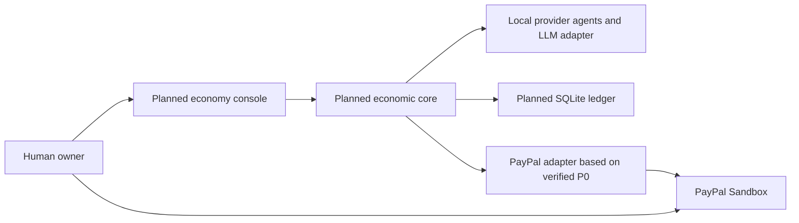

# Credence

**Let agents trade capabilities, not credentials.**

Credence is a planned AI Agent Economic Runtime: agents purchase capabilities within an owner's bounded internal allowance, verify deliveries, accumulate accepted service charges, and ask the owner to settle one aggregate bill. Deterministic application code controls spending and accounting; agents never receive payment credentials.

The motivation is to give agents useful economic autonomy while making every decision, reservation, delivery, and payment accountable. Internal Credit is an accounting allowance, not lending or PayPal-provided financing. The hackathon target is the PayPal AI Hackathon 2026; Alipay adaptation is a future possibility only.

Repository: [weihong363/credence](https://github.com/weihong363/credence) (private; public release pending). Console screenshot: **[SCREENSHOT — pending]**. Demo video: **[YOUTUBE_URL — pending]**.

## What works today

Only **P0, the PayPal Sandbox compatibility spike**, is implemented. P1–P4 are specified, not built.

| Capability | Current status |
| --- | --- |
| Server-side OAuth, Orders v2 create/get/capture | Implemented; recorded live Sandbox verification |
| Three simulated service charges, one fixed bill | USD 1.25 + 2.50 + 3.75 = **USD 7.50**, one receiver |
| Buyer approval and completed capture | Recorded order `0LX18082EW768591D`, capture `3V026169LS895662F` |
| Repeated settlement and graceful server restart | Recorded unchanged receipt and exactly one PayPal capture |
| Negative testing | Live Sandbox injected HTTP 422; local tests cover decline, cancellation, timeout and retry |
| Real agents, service delivery verification, credit accounts | Planned P1; fixture `verified: true` is not service evidence |
| Append-only ledger, transactional reservations, multiple batches | Planned P1/P2; P0 stores one mutable JSON snapshot |
| Agent Economy Console | Planned P3; current server has no application UI |
| AUTHORIZE, payouts, split payments, real lending | Deferred or out of scope |

Evidence is historical, dated 2026-10-21; documentation checks do not imply a new live payment. See the [compatibility report](docs/paypal-sandbox-compatibility.md), [settlement evidence](docs/phase0-settlement-evidence.json), and [negative-test evidence](docs/phase0-negative-evidence.json). A negative-test response is injected by Sandbox, not a genuine buyer funding failure. Power-loss durability, real capture-time network loss, and independent Activity-page inspection are not established.

## Architecture

Today: Node HTTP server → fixed settlement/store → PayPal Sandbox, with owner Bearer authentication and local durable JSON storage. Planned: a TypeScript modular monolith containing a registry, coordinator, deterministic policy/reservation engine, provider handlers, delivery verification, transactional ledger, and settlement service. Only the payment module holds PayPal secrets.



## Stack

Current: Node **20.19+**, TypeScript strict mode, ESM/NodeNext, native `node:http` and `fetch`, pnpm **10.33.4**, `tsx`, and `node:test`. No framework, database, AI SDK or frontend dependency is installed. Planned additions are SQLite with `better-sqlite3` for atomic financial operations, and Vite with vanilla TypeScript for the console; see [technical decisions](docs/spec.md). No production hosting is configured.

## Quick start: current P0

```sh
pnpm install --frozen-lockfile
cp .env.example .env
```

Fill `.env` locally. Do not overwrite an already configured `.env`, commit secrets, or paste them into an LLM. Generate a separate owner token, for example with `openssl rand -hex 32`, and enter its output locally.

| Current server variable | Required | Meaning |
| --- | --- | --- |
| `PAYPAL_CLIENT_ID` | Yes | Sandbox REST app Client ID |
| `PAYPAL_CLIENT_SECRET` | Yes | Server-only Sandbox app secret |
| `PAYPAL_MERCHANT_ID` | Yes | Same app's receiving Sandbox Business merchant ID |
| `OWNER_TOKEN` | Yes | At least 32 random characters; local owner API credential |
| `PUBLIC_URL` | Default supplied | Must be `http://localhost:3000` in P0 |

The development command loads `.env` natively. Existing shell variables take precedence. No `LLM_*` variables are consumed yet; future configuration is specified separately.

```sh
pnpm check
pnpm test
pnpm dev
```

The server listens only on `127.0.0.1:3000`. The current package name remains `a2a-paypal-spike`; its scripts are authoritative. There is no `build`, `lint`, migration, or frontend command yet.

## Sandbox setup and walkthrough

Create a REST app associated with one Sandbox Business account. Locate that account's merchant ID, and use a **different Sandbox Personal account** as buyer. See [PayPal Sandbox setup](https://developer.paypal.com/sandbox-testing/accounts) and the [manual verification guide](docs/paypal-sandbox-compatibility.md).

With `OWNER_TOKEN` exported in the terminal (loading `.env` for the server does not export it into your terminal):

```sh
curl --fail-with-body -X POST http://localhost:3000/api/create -H "Authorization: Bearer $OWNER_TOKEN"
# Open the returned approval URL, log in as Sandbox Personal buyer, and approve.
curl --fail-with-body -X POST http://localhost:3000/api/capture -H "Authorization: Bearer $OWNER_TOKEN"
curl --fail-with-body -X POST http://localhost:3000/api/verify -H "Authorization: Bearer $OWNER_TOKEN"
```

The browser return message is not proof of capture. Backend API verification must establish a matching completed capture. If previously cancelled, explicit owner authorization and `POST /api/resume` are required before capture. Cancellation does not refund an existing capture.

P0 intentionally supports one fixed bill. If it is already settled, these requests return that receipt. **Do not delete or edit an unresolved ledger to force another payment.** On a fresh clone, the above flow creates a new real Sandbox order and requires buyer approval; it is not a mock checkout.

## Tests and recorded evidence

`pnpm test` runs 18 local mocked tests as of the documentation audit. `pnpm check` checks source, tests and verification scripts. For an existing completed bill with the server running:

```sh
pnpm verify:phase0
pnpm verify:phase0 --negative
```

The first command checks three-charge/order association, repeats owner API requests and checks PayPal independently. The second adds the official decline-response injection against the already-completed order. They write sanitized evidence JSON files; a fresh clone without a settled local ledger cannot run them successfully. Keep payment evidence separate from local unit-test results.

`.data/settlement.json` is local state, not a public ledger. A process lock prevents two spike servers from sharing it. Following a crash, confirm no server is running before removing only `.data/process.lock`; preserve the settlement. Never copy the state into independent active servers.

## Roadmap and limitations

[P1](docs/roadmap.md): real local service procurement, atomic Credit, accepted deliveries and append-only ledger, without PayPal. P2: multi-charge frozen batches connected to the existing Sandbox transport. P3: observable Agent Economy Console and five consecutive complete demonstrations. P4: public, reproducible submission and English video under three minutes. These phases require explicit implementation approval.

Start with [product requirements](docs/product.md), [authoritative specification](docs/spec.md), [accounting and settlement](docs/settlement.md), [execution roadmap](docs/roadmap.md), [demo storyboard](docs/demo-script.md), and [ADRs](docs/decisions/README.md).

No provider receives a separate payment in this single-merchant experiment. No lending, interest, automatic account debit, production PayPal, marketplace payouts, external A2A network, or Alipay integration is implemented.

## License and submission readiness

**No license file exists yet.** Source publication, an owner-selected open-source license, and repository/video URLs are P4 tasks; this repository must not be represented as submission-ready or licensed open source today. Review the [official competition rules](https://paypalaihackathon.devpost.com/rules) before publication. Do not publish credentials for reproducibility: reviewers configure their own Sandbox app and AI key.
