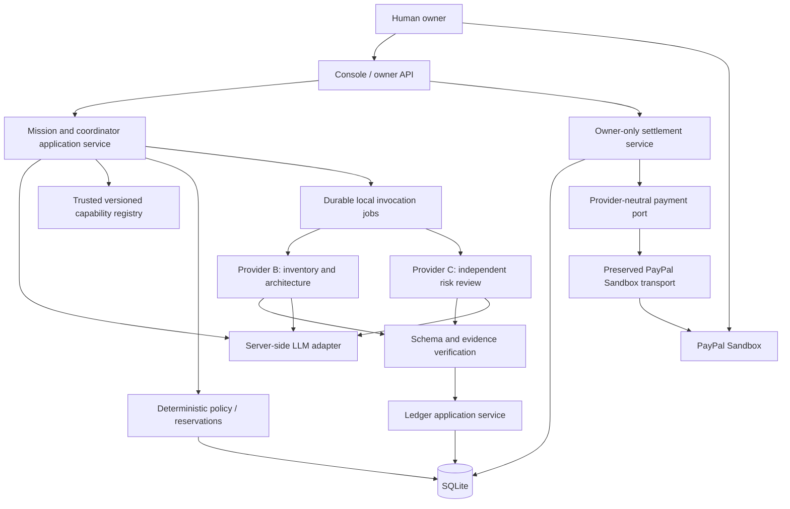
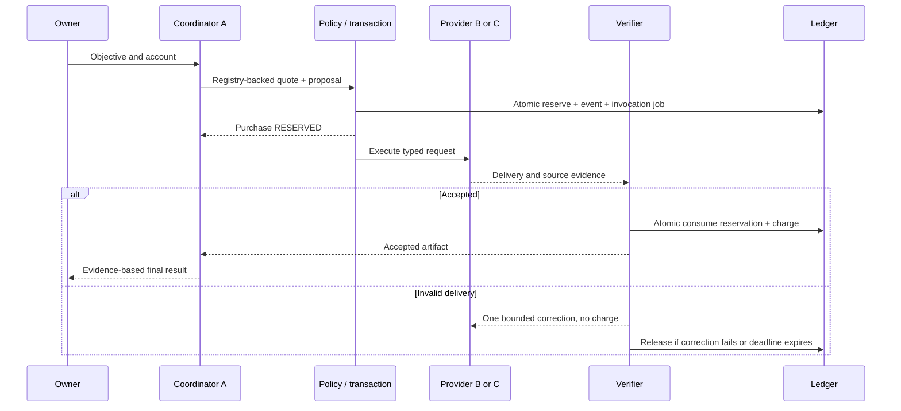
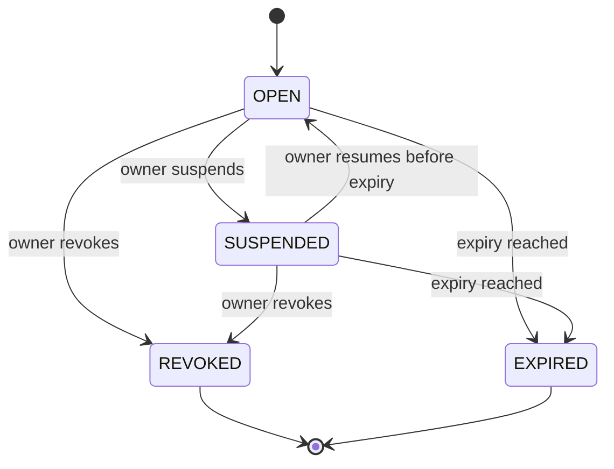

# Authoritative implementation specification

Version 1, 2026-10-21. **Planned P1–P4; not implemented.** Current behavior is inventoried below. [Product](product.md) defines scope, [settlement](settlement.md) defines financial invariants and payment recovery, [roadmap](roadmap.md) defines ordered work, and [ADRs](decisions/README.md) record decisions. If documents conflict, stop and resolve them before a financial change; do not silently choose a rule.

## 1. Current repository audit

| Surface | Observed implementation | Boundary |
| --- | --- | --- |
| src/server.ts / src/config.ts / src/http.ts | Native Node HTTP, owner Bearer token, configurable HOST/PORT/DATA_DIR, HTTPS origin validation, health, state-bound return/cancel routes | No sessions, frontend, request body parser, multi-owner routing or webhook endpoint |
| src/paypal.ts | Sandbox-only OAuth, Orders create/get/capture, token cache, three-attempt transport retry, sanitized issue codes | `Gateway` and `Order` expose PayPal shapes; not a provider-neutral economic interface |
| src/settlement.ts | Fixed three-charge bill, 1,000-unit fixture bound, one JSON snapshot, exclusive process lock, terminal receipt, explicit resume | No dynamic purchases, atomic credit accounts, append-only ledger, database, multiple batches or real service verification |
| scripts/verify-phase0.ts | Checks real order/charge association, repeats local requests, official negative header probe | Requires an already-settled local bill; negative probe targets the completed order, not a new real funding decline |
| test/settlement.test.ts / test/deployment.test.ts | 25 local settlement/config/HTTP tests with mocked PayPal | Not proof of real service execution, real network loss or concurrent multi-process accounting |
| docs/phase0-*.json | Sanitized recorded live USD 7.50 order/capture, unchanged receipt, one capture, injected HTTP 422 | Historical evidence, not an append-only audit system or a new live check on every docs run |

P0 is complete within those limits. `.data` is mutable trusted local state and Object.freeze is not tamper-proof storage. The in-process gate and lifetime file lock do not replace database transactions. Settled `verify` short-circuits locally; independent script GET is the fresh remote check. Normal SIGINT/SIGTERM cleans the lock; a hard crash requires checked manual recovery. Capture and order IDs are bound in the receipt but individual P0 charges have no real purchase/delivery IDs.

Corrective work to schedule, not change here: safe byte-length credential comparisons; finite body size/JSON/schema validation for new APIs; durable authorization intent and job ownership; explicit normalized states instead of mixed PayPal/local strings; 429 Retry-After handling; JSON shape validation instead of trusting TypeScript casts; fresh payment reconciliation after settlement without mutating the historical receipt; durable database constraints. P0's broad error-to-UNKNOWN behavior is conservative and does not mean a confirmed decline is a successful payment.

## 2. Architecture and stack decisions

Keep Node 20.19+, strict TypeScript, ESM, pnpm, native fetch/node:http and node:test. Planned SQLite via **better-sqlite3** is justified for transaction/uniqueness guarantees absent from the JSON store; choose and lock a Node-20-compatible version during P1 setup and verify native installation. Do not upgrade the runtime or install a second DB/ORM without revisiting this decision. Use parameterized SQL, numbered SQL migrations, foreign_keys=ON, journal_mode=WAL, synchronous=FULL, busy_timeout=5000. One application process and one local DB; no shared network filesystem.

P3 uses Vite with vanilla TypeScript, DOM components and CSS; no global frontend state library. It is a planned development dependency, not installed today. Production-like local demo serves built assets from the same Node origin; dev proxy must preserve same-origin authentication. Frontend never imports backend secrets or database modules. P1/P2 have CLI/HTTP acceptance paths before UI.



Planned modules (none exist yet): `src/domain/{money,policy,purchase,ledger,settlement}.ts`; `src/application/{missions,procurement,deliveries,settlements,reconcile}.ts`; `src/registry/`; `src/providers/`; `src/llm/`; `src/persistence/{migrations,repositories,transactions}.ts`; `src/jobs/`; `src/payments/{port,paypal-adapter}.ts`; `src/http/`; `web/`; `test/{unit,integration,e2e}/`. Domain code is pure. Application services own transactions and authorization. Repositories accept transaction handles; providers cannot import persistence/payments. Payment transport reuse comes in P2, not during P1.

## 2a. Sponsor integration boundaries (planned)

See [sponsor resource decisions](sponsor-resources.md) for dated offers, licensing, evaluation gates and effort. No sponsor integration is installed. Preserve native HTTP/fetch, SQLite, monolith jobs and Vite/vanilla TypeScript. Postman is external testing/reproduction tooling; APIMatic is optional developer context. Neither is economic authority. Optional AG Studio consumes sanitized read models only; no client-side ledger writes or unrestricted payment tools, and no framework change.

Prioritize Render public demo deployment in P3/P4 while retaining the reproducible local path. Minimal P0 hosting preparation is now implemented in [deployment-render.md](deployment-render.md), without creating cloud resources. The full runtime still needs its own hosted acceptance. Its profile includes: bind `0.0.0.0` on Render's PORT, configured trusted HTTPS PUBLIC_URL with exact host/origin/callback validation, Secure sessions and CSRF, authorized mutations, rate limits and non-sensitive health checks. Public visitors default to sanitized read-only views; owner-controlled execution/spending is never open anonymously. PayPal and LLM secrets remain server-managed environment values, never frontend build variables.

Plan one paid instance with a mounted persistent directory for SQLite (including WAL/SHM), artifacts and recoverable state. Apply migrations at runtime before serving, under exclusive database ownership. Persist jobs and drain/finish or checkpoint before shutdown; reconcile uncertain payments after restart. Do not run disk-dependent migrations in build/pre-deploy jobs. No autoscaling/shared SQLite, free ephemeral financial state or distributed Workflows SDK. Use consistent database backups and provider reconciliation before resuming after restore. Verify native SQLite build, restart/deploy durability, owner approval/callbacks, HTTPS auth and replay against the deployed instance before declaring it ready. Confirm credits/budget and availability through judging; hosting has an incremental cost and is not yet configured.

## 3. Identity, data types and configuration

All new IDs are application UUID strings; relationships use explicit IDs, never labels parsed from model prose. Times are UTC ISO strings at boundaries and integer epoch milliseconds in DB, supplied by injected clocks for tests. Hashes are SHA-256 over canonical JSON or raw artifact bytes; canonical JSON sorts object keys recursively, preserves array order, disallows undefined/NaN. Integers must be safe, nonnegative and bounded to 1,000,000,000 minor units for individual values and sums. USD is the only accepted currency (two fractional digits); reject other currencies and decimal-valued API amounts. UI formatting is derived, never authoritative.

Credit units map 1:1 to USD cents for the MVP. Domain money is `{ currency: 'USD', minor: number }`; public amounts are integer minor units, PayPal amounts are converted to exactly two decimal digits. A limit is not a stored cash balance. Reserved and outstanding are transaction-maintained projections verified from ledger events.

Future server configuration: `CREDENCE_DB_PATH` (default `.data/credence.sqlite`), `ARTIFACT_DIR` (`.data/artifacts`), existing owner/PayPal variables, `LLM_BASE_URL`, `LLM_MODEL`, `LLM_API_KEY`. The initial LLM transport targets a configured OpenAI-compatible `/chat/completions` HTTP endpoint using native fetch; model name and endpoint must be chosen and verified before P1's live AI gate, with no built-in model default. This is a planned adapter contract, not a claim every vendor supports the same JSON/schema options. Send messages and request JSON text; validate locally regardless of vendor output modes. Set a 30-second timeout and at most one retry for transient failures, maximum output budget 2,000 tokens per call, maximum eight calls per mission. A real provider configuration and model capability test are explicit P1 dependencies, never silently replaced by hardcoded results.

## 4. Entity model and schema contract

Use versioned migrations. Every FK is enforced; owner/account scope is checked in application transactions because a UUID alone does not grant access. JSON fields are validated against versioned application schemas on write/read. Status strings use CHECK constraints for the exact enums below. Schema notation: PK primary key; FK reference; UQ unique. Monetary integers are NOT NULL with nonnegative CHECKs; actual migration SQL must encode these constraints, including listed partial indexes.

| Table | Required columns / constraints |
| --- | --- |
| owners | id PK, created_at; MVP seeded single local owner |
| agents | id PK, owner_id FK, role BUYER/PROVIDER, name, active |
| capabilities | id, version composite PK; provider_id FK agents, input_schema_json, output_schema_json, pricing_minor, currency, handler_key, available, timeout_ms, verification_version; immutable version rows |
| accounts | id PK, owner_id FK, buyer_id FK, currency, limit_minor, reserved_minor default 0, outstanding_minor default 0, per_purchase_minor, allowlist_json nullable, expires_at nullable, status OPEN/SUSPENDED/REVOKED, version; CHECK reserved+outstanding<=limit |
| tasks | id PK, owner_id/account_id/buyer_id FKs, objective, input_json, status, budget_minor, spent_minor, deadline_at, result_artifact_id nullable, created_at |
| quotes | id PK, task_id/capability_id+version/provider_id FKs, input_hash, acceptance_hash, amount_minor, currency, expires_at, created_at; immutable; one successful purchase per quote |
| purchases | id PK, task_id/account_id/quote_id FKs, quote_id UQ, buyer_id/provider_id, status, input_json, input_hash, acceptance_json, amount_minor, currency, deadline_at, version, created_at |
| reservations | id PK, purchase_id UQ FK, account_id FK, amount_minor, state HELD/CONSUMED/RELEASED, expires_at; terminal states never return to HELD |
| invocations | id PK, purchase_id UQ FK, request_hash, state QUEUED/RUNNING/COMPLETED/FAILED/TIMED_OUT, lease_until, execution_attempts, started_at, finished_at |
| deliveries | id PK, purchase_id FK, attempt_no 1..2, request_id FK invocations, output_json, artifact_id FK nullable, output_hash, started_at, finished_at; UQ(purchase_id,attempt_no); immutable |
| verifications | id PK, delivery_id FK, verifier_version, schema_valid, objective_checks_json, quality_review_json, result PASS/CORRECTION_REQUIRED/FAIL, reason_codes_json, created_at; UQ(delivery_id,verifier_version) |
| artifacts | id PK, task_id FK, relative_path, sha256, byte_size, media_type, created_at; no arbitrary file paths accepted from agents |
| ledger_events | id PK, seq INTEGER UQ increasing, account_id FK, task_id/purchase_id FKs nullable for batch-level events only, type, amount_minor, currency, reservation_id nullable, charge_id nullable, batch_id nullable, reversal_of FK nullable, dedupe_key UQ, payload_hash, created_at; immutable |
| charges | id PK, accepted_purchase_id UQ FK, accepted_delivery_id FK, ledger_event_id UQ FK, account_id/task_id FKs, amount_minor, currency; immutable projection anchored to SERVICE_CHARGED |
| batches | id PK, owner_id/account_id FKs, currency, merchant_config_id, total_minor, allocation_hash, state, cancel_latched, version, created_at, frozen_at; frozen financial fields immutable |
| allocations | id PK, batch_id/charge_id FKs, amount_minor, state LOCKED/SETTLED/RELEASED, created_at; UQ(batch_id,charge_id); partial UQ(charge_id) WHERE state IN ('LOCKED','SETTLED'); full charge only |
| payment_attempts | id PK, batch_id UQ FK, provider, create_key UQ, capture_key UQ, provider_order_id UQ nullable, provider_capture_id UQ nullable, create_started_at/capture_started_at nullable, normalized_status, verified_at nullable; persistent checkpoints |
| payment_observations | id PK, attempt_id FK, order_status, capture_status nullable, amount_minor nullable, currency, merchant_matches, observed_at, safe_error_codes_json; append-only sanitized observations |
| economic_audit | id PK, seq INTEGER UQ increasing, account_id/task_id/purchase_id/batch_id nullable FKs, actor_id, actor_kind OWNER/COORDINATOR/SERVICE/SYSTEM, action, reason, created_at; no private model reasoning |
| idempotency_requests | owner_id, operation, key composite PK, request_hash, resource_id nullable, state IN_PROGRESS/DONE, response_json nullable, created_at; application replay record |
| jobs | id PK, type, resource_id, state READY/RUNNING/DONE/ACTION_REQUIRED, lease_until, attempts, next_attempt_at, dedupe_key UQ |
| webhook_inbox | provider, event_id composite PK, payload_hash, received_at, processed_at nullable, state; reserved P2, no endpoint required in MVP |

Ledger/charges/deliveries/verifications/quotes/payment observations/economic audit rows cannot be UPDATEd/DELETEd: DB triggers reject mutations. Projections can change only via application transactions paired with history. Every committed workflow/financial transition also appends a sanitized economic_audit entry in the same transaction; its sequence is the task timeline cursor. Ledger events keep their own financial sequence. Task spent_minor counts holds plus accepted work including paid work: reserve adds, rejection/release subtracts, acceptance and settlement do not change it, and an eligible pre-payment reversal subtracts. Use explicit column lists and migration tests. Enforce unique accepted verification/charge in the acceptance transaction; rejected or unaccepted attempts cannot be charge sources. No database-level tamper-proof claim against a local administrator. Backups and hashes improve audit/recovery, not external trust.

## 5. Registry and agent contracts

Seed coordinator A and providers B/C under the local owner. Handler resolution is a code-controlled map, never a model-supplied URL or import. Registry entries include trusted code identity; advertising a capability does not establish output quality. Changes create a new capability version; outstanding quotes retain their snapshot.

| Capability v1 | Provider | Price | Real work and output | Objective checks |
| --- | --- | --- | --- | --- |
| repo.inventory | B | 125 | Fetch pinned public repository metadata/tree and bounded source; language/file/build/test inventory | Repository/revision match; evidence artifact hash; all listed paths exist |
| repo.architecture | B | 250 | Live LLM analyses pinned source into components, entry points, dependencies | At least two components or explicit insufficient-evidence rejection; cited files/line ranges exist and text anchors match |
| repo.risk-review | C | 375 | Independent live LLM review of pinned source without B's conclusions | At least three supported risks across at least two files; severity/evidence/mitigation fields; matching source anchors |

Default per-provider timeout 60 seconds; total purchase deadline 90 seconds; quote TTL 120 seconds; task execution budget five minutes excluding human settlement. Capability schema carries these bounds. Reject inputs too small for required acceptance checks before quoting when objectively detectable. Do not invent risks to satisfy a count; evidence insufficiency fails visibly.

Mission input schema: `{ repository: { owner, name, commitSha? } }`. Resolve an omitted revision once before quotes, record exact commit SHA in a snapshot. Only public `api.github.com` and its fixed repository-content endpoints are allowed; deny arbitrary host URLs, redirects to other hosts, private repositories, symlinks and path traversal. Maximum 100 text files, 200 KiB per file, 1 MiB total source, paginated bounded requests. Ignore binary/oversize files and record exclusions. Never clone/run repository code. Inputs are untrusted data, including README instructions; do not follow embedded prompts. Optional GitHub token remains server-only and must not be required for public fixtures if rate limits permit.

```ts
// Planned public application contracts, not existing exported interfaces.
interface PurchaseProposal {
  taskId: string; capabilityId: string; capabilityVersion: number;
  quoteId: string; reason: string; // <= 500 characters; no model price override
}
interface InvocationRequest {
  requestId: string; purchaseId: string; taskId: string;
  buyerId: string; providerId: string; capabilityId: string; version: number;
  input: unknown; inputHash: string; deadlineAt: string;
}
interface DeliveryEnvelope {
  requestId: string; purchaseId: string; taskId: string; providerId: string;
  attempt: 1 | 2; output: unknown; outputHash: string;
  artifactIds: string[]; startedAt: string; finishedAt: string;
  evidence: { artifactId: string; path: string; startLine: number; endLine: number; anchor: string }[];
}
```

Version-1 payload schemas must be explicit local schema constants, not free-form model requests:

- All capability inputs: `{ repository: { owner: string, name: string, commitSha: string }, snapshotId: UUID }`, no additional properties. Owner/name are validated repository identifiers, SHA is the resolved 40-character commit hash, snapshot belongs to the task. Architecture and risk capabilities use the same immutable snapshot; they do not trust a provider-supplied remote URL.
- Inventory output: `{ repository, commitSha, files: [{ path, language, sha256 }], entryPoints: string[], buildCommands: string[], testCommands: string[], exclusions: [{ path, reason }] }`. Paths/commands must have source evidence; an unknown command is an empty list plus limitation, never guessed or executed. Maximum 100 files, 20 commands and 20 entry points.
- Architecture output: `{ repository, commitSha, components: [{ name, responsibility, evidenceIndexes: number[] }], dependencies: [{ from, to, evidenceIndexes: number[] }], limitations: string[] }`. Between 2 and 20 components; at most 50 edges; every edge references an included component and every claim references a valid envelope evidence index.
- Risk output: `{ repository, commitSha, risks: [{ category, severity, claim, mitigation, evidenceIndexes: number[] }], limitations: string[] }`. Between 3 and 20 risks; category is SECURITY/RELIABILITY/MAINTAINABILITY/ADOPTION; severity is LOW/MEDIUM/HIGH; at least two distinct cited paths. Unknown evidence or insufficient source fails objective acceptance rather than forcing invented claims.
- Each delivery has at most 100 evidence anchors; paths must exist in the pinned snapshot, line ranges are positive and within the file, and anchor text must match the exact range. Narrative strings are capped at 4,000 characters each, short labels at 120, output JSON at 64 KiB. Artifact references contain IDs, not executable HTML or arbitrary paths. No extra fields are accepted.
- Final mission result: `{ repository, commitSha, recommendation: 'ADOPT' | 'ADOPT_WITH_CONDITIONS' | 'DO_NOT_ADOPT' | 'INSUFFICIENT_EVIDENCE', summary, findings: [{ claim, acceptedDeliveryIds: UUID[] }], limitations: string[] }`. A claim must point to this task's accepted delivery; a failed mission can expose partial accepted findings but cannot label unaccepted output as verified.

The snapshot metadata travels as typed application data even where the model never sees source hashing internals. Generic future capabilities supply their own schemas and verifier versions; repository-specific rules do not leak into the ledger.

Provider output is schema-validated and tied to invocation identity, source hashes and task ownership. Schema validation, objective evidence checks and subjective review are stored separately. Cross-agent review is useful but not proof of truth. Optional subjective owner review holds the reservation only until the purchase deadline; timeout rejects, never auto-accepts. Demo fixture can deterministically omit a required evidence anchor on delivery attempt 1; label that injection, then let the real provider correct once with actual evidence.

Coordinator uses tools `listCapabilities`, `requestQuote`, `proposePurchase`, `getPurchase`, `getAcceptedDelivery`. Tools derive actor/account from task context. No SQL, payment method, owner token or raw secret tool exists. Quotes are generated from application-owned task input/snapshot and versioned acceptance rules: recompute and compare both hashes server-side, snapshot price/currency/provider/version/expiry, and reject any caller-supplied hash that disagrees. Model or client cannot weaken acceptance conditions. Validate model JSON strictly; up to one repair response within the eight-call budget, then action-required. Maximum five purchase proposals per task, no duplicate purchase for the same capability/version/input/acceptance hash unless owner starts a new task. Registry filtering and quoting are deterministic; model makes suitability decisions and synthesis, not ledger writes. Store short decision summaries and tool results, never chain-of-thought.

## 6. State machines, execution and recovery

Purchase state is separate from settlement. ACCEPTED remains the purchase's outcome after its charge is paid.

| From → to | Actor/conditions | Reservation / effects |
| --- | --- | --- |
| No purchase → RESERVED | Procurement; unexpired authoritative quote, matching hashes, active policy, idempotency, sufficient account/task limits | Atomic HELD reservation and CREDIT_RESERVED; quote consumed once |
| RESERVED → EXECUTING | Durable runner claims invocation before deadline | Hold; persist job ownership before calling provider |
| EXECUTING → DELIVERED | Registered provider; validated identity, request and result envelope | Hold; immutable delivery and verification job |
| DELIVERED → ACCEPTED | Verifier PASS before deadline | HELD→CONSUMED, reserved−price, outstanding+price, one SERVICE_CHARGED |
| DELIVERED → CORRECTION_REQUIRED | Failed check on attempt 1 with time remaining | Hold; audit reason; no charge |
| CORRECTION_REQUIRED → EXECUTING | Same invocation identity, attempt 2, before original deadline | No additional quote/reservation or deadline extension |
| DELIVERED → REJECTED | Attempt 2 fails or no correction permitted | RELEASED, reserved−price, CREDIT_RELEASED |
| RESERVED/EXECUTING/CORRECTION_REQUIRED/DELIVERED → CANCELLED | Owner cancellation wins transaction before acceptance | Release exactly once; late result stored only as non-accepting audit |
| Any nonterminal → FAILED | Deadline, service exception, unrecoverable recovery error | Release once; no charge |

Quote has AVAILABLE→USED or EXPIRED; AVAILABLE is derived from expires_at and no consumed purchase. Expired quotes do not mutate into purchases. Terminal purchase states are ACCEPTED/REJECTED/FAILED/CANCELLED. Delivery attempts are immutable; no overwrite to “fix” evidence. Acceptance/cancellation races use compare-and-swap version inside BEGIN IMMEDIATE; exactly one wins. Completion after expiry is rejected even if a model called it successful. Accepted charges require compensating corrections, not purchase status rewrites.

Jobs are persisted in the same transaction as state transitions. One runner polls due jobs, claims a 30-second lease and heartbeats every 10 seconds. Deadlines are absolute. On restart, reconcile HELD reservations and unfinished invocations: reacquire expired leases; local read-only execution may rerun with the same invocation ID, at most twice total execution attempts, and only before deadline. Output acceptance/charges stay unique even if compute repeats. Terminal or expired purchases release stale holds; accepted ones consume them. Never promise exactly-once external computation. Source snapshot artifacts must survive restart; incomplete temporary files are excluded until hash verified and atomically published.



Credit policy details are in [settlement](settlement.md). Revocation/suspension prevents new reservations; existing accepted charges remain payable. On suspension/revocation, cancel all not-yet-accepted purchases transactionally, releasing holds; in-flight late results cannot charge. Expiry has the same effect when the deadline sweeper observes it; acceptance also rechecks policy expiry. Owner confirmation may settle obligations even when account is suspended/revoked.



EXPIRED is derived from expires_at, not a fourth stored status. No automatic renewal. Balances are orthogonal to policy state. Task states QUEUED/RUNNING/SUCCEEDED/FAILED/CANCELLED/ACTION_REQUIRED do not encode payment status. A task may succeed with outstanding obligations; failed tasks still owe already accepted charges. The mission endpoint returns outstanding separately.

## 7. HTTP contracts and authorization

P0 existing endpoints remain as documented in README until P2 cutover. The following `/api/v1` API is **planned**, not available. Every list is owner-scoped, cursor-paginated (default 50, max 100), ordered by creation timestamp and UUID tie-breaker. Times use UTC and amounts use minor integers. JSON bodies max 64 KiB; artifacts are separately bounded and fetched through authorized IDs. Reject unknown fields, malformed IDs, wrong ownership and unsupported currencies.

| Method / route | Input → output | Authority |
| --- | --- | --- |
| GET /capabilities | optional active filter → versioned metadata/schemas/prices | Owner or task-scoped coordinator |
| POST /accounts | buyerId, limitMinor, perPurchaseMinor, allowlist?, expiresAt? → account + balances | Owner |
| PATCH /accounts/:id/policy | expectedVersion, changed policy fields → versioned policy | Owner; lowering limit below reserved+outstanding rejected |
| POST /tasks | objective, input, accountId, budgetMinor → task ID/status | Owner |
| POST /tasks/:id/quotes | capabilityId, version, inputHash, acceptanceHash → immutable quote | Task-bound coordinator/application |
| POST /tasks/:id/purchases | quoteId, reason → purchase, reservation, available | Coordinator or owner through same policy |
| POST /purchases/:id/cancel | expectedVersion → purchase | Owner |
| GET /tasks/:id | status, safe decisions, purchase summaries, accepted result, outstanding | Owner |
| GET /tasks/:id/events | afterSeq cursor → ordered sanitized audit events | Owner; poll every second in UI |
| GET /purchases/:id | quote, status, delivery/verification summaries | Owner or owning coordinator |
| GET /accounts/:id/ledger | cursor → ledger + derived balances | Owner |
| GET /artifacts/:id | metadata or bounded download | Owner; task-scoped read for coordinator |
| POST /batches | accountId, chargeIds[] → frozen batch and allocations | Owner only |
| POST /batches/:id/order | no amount fields → attempt + approval URL | Owner only |
| POST /batches/:id/capture | expectedVersion → payment status; 202 if unknown/pending | Owner only, after human PayPal approval |
| POST /batches/:id/cancel | expectedVersion → cancellation latch | Owner only; not a refund |
| POST /batches/:id/resume | expectedVersion, confirm:true → status | Owner only; approved original order required |
| POST /batches/:id/reconcile | no financial overrides → authoritative observation/batch | Owner or internal recovery job |
| GET /batches/:id | allocations, safe payment IDs/status, action required | Owner |

All state-changing owner/coordinator HTTP requests require `Idempotency-Key` (UUID) except read-like reconcile, which still dedupes observations/finalization. Scope is owner+operation+key; hash canonical input. Same key/hash returns the original resource with its current status; differing body returns 409 IDEMPOTENCY_CONFLICT. A business unique constraint also blocks a new key from repurchasing a quote or allocating a charge twice. Derive provider keys from persisted attempts; HTTP retry keys are never passed blindly to PayPal.

Success envelope `{ data, requestId }`; error `{ error: { code, message, retryable, resourceId? }, requestId }` with sanitized stable codes. 400 invalid input, 401 unauthenticated, 403 wrong scope, 404 unknown/inaccessible resource, 409 state/idempotency conflict, 422 policy/delivery rejection, 202 action still pending, 503 unavailable provider. Timeouts never imply a new financial resource. Read endpoints may return UNKNOWN with reconciliation instructions.

P1 local CLI/HTTP uses owner Bearer authentication and in-process task-scoped tools. P3 adds owner login that exchanges the token for a random server-side session (one-hour lifetime), HttpOnly SameSite=Strict cookie, Secure when TLS exists, CSRF token plus exact Origin check on mutations, and logout/revocation. Never place owner tokens in browser storage, model prompts or URLs. Callback state is a separate one-time random capability with stored hash and batch binding; callback validates order association and merely schedules a GET. It cannot capture or clear cancellation. Artifact downloads cannot expose `.env`, absolute paths or unowned task data.

## 8. Planned payment port and cutover

```ts
interface PaymentPort {
  createOrder(input: { batchId: string; minor: number; currency: 'USD';
    merchantConfigId: string; requestKey: string; returnUrl: string; cancelUrl: string }): Promise<PaymentObservation>;
  captureOrder(orderId: string, requestKey: string): Promise<PaymentObservation>;
  inspectOrder(orderId: string): Promise<PaymentObservation>;
}
interface PaymentObservation {
  orderId: string; captureId?: string;
  status: 'AWAITING_APPROVAL' | 'APPROVED' | 'PENDING' | 'COMPLETED' | 'FAILED' | 'UNKNOWN';
  currency?: 'USD'; minor?: number; batchReference?: string; merchantMatches: boolean;
  approvalUrl?: string; observedAt: string; safeErrorCodes: string[];
}
```

Only the adapter maps PayPal statuses/types, looks up merchant configuration and converts decimals. It validates provider response schemas, unique completed capture, total, merchant, custom_id and order association. COMPLETED is trusted only from authenticated inspectOrder, not a redirect or returned capture POST. P0's PayPal class remains a reusable transport; tests must prove payload/retry behavior survives the P2 adapter wrapper.

P1 does not migrate, mutate or reissue P0 fixture obligations. P2 first adds adapter contract tests against the P0 transport, then routes new real-charge batches to the SQLite service. Preserve P0 files/evidence as an isolated spike; archive its fixed-bill route/runner during the documented cutover, with an explicit regression path, not a dual authority over any charge. If the old receipt is displayed, label it historical fixture evidence and never allocate those simulated charges as P1 purchases. No automatic conversion of its JSON into real SERVICE_CHARGED records. Migration of unresolved P0 payments requires separate reconciliation before disabling the old server; the recorded P0 bill is completed.

Full settlement transitions, idempotency, refunds and webhook policy are in [settlement](settlement.md).

## 9. Tests, observability and acceptance

| Layer | Required tests |
| --- | --- |
| Pure domain | Integer overflow/currency rejection; policy bounds; all allowed/forbidden state transitions; expired quote/allowlist/suspension |
| SQLite integration | Real transaction rollback; two independent connections competing for last Credit; one wins; quote/purchase uniqueness; append-only triggers; balance replay; acceptance/cancel race; allocation competition |
| Provider and model contracts | Recorded fixtures explicitly mocked; schema/identity/hash/anchor failures; live useful AI output in separate opt-in acceptance run; prompt injection cannot call forbidden tools |
| Crash/job recovery | Terminate after reserve, before acceptance, after acceptance and around external payment checkpoints; restart returns consistent state; injected ambiguous response cannot create a new order |
| Payment port | P0 regression plus multi-batch mapping, declines/pending/unknown, exact totals, wrong merchant/ID, repeated requests/events, fixed retry keys and expired retry-window block |
| Live P2 | Three real executions → three accepted charges → one real Sandbox approved/captured payment; independent GET and ledger reconciliation; no manual DB edits |
| P3 end-to-end | Five consecutive clean tasks/batches on persistent state; one rejected/corrected attempt; budget denial; cancel/resume; visible artifacts and final result |

Task SUCCEEDED requires all capabilities marked required by the task plan to have accepted deliveries and a schema-valid final result. On unrecoverable required-service failure, task is FAILED with optional partial findings; accepted charges remain payable. ACTION_REQUIRED pauses automatic work after a policy/model/operator blockage; the MVP owner can inspect and cancel or start a new task, not extend its original budget/deadline through an undocumented resume. Task CANCELLED stops future purchases and cancels nonterminal ones but does not reverse accepted work.

Use fake clocks, controlled fixture servers and temporary DBs. Live API/model tests are opt-in and never called by default unit tests. Do not send any new payment during this documentation task. Test jobs/transport separately from quality assertions. Log IDs, concise decision reasons, timestamps and safe error codes, not credentials or raw source/payer payloads. Owner-facing event order follows committed sequence numbers, not network arrival order. Module tests and link checks must pass before acceptance; a phase checkbox needs its explicit evidence, not only generated files.

## P0 deployment preparation boundary

`render.yaml`, `.node-version`, `.env.render.example`, `tsconfig.build.json` and backend configuration are prepared for one native Node service and durable JSON state. `pnpm build` emits dist/server.js; `pnpm start` consumes platform environment without tsx/.env. HOST/PORT/DATA_DIR and strict PAYPAL_BASE_URL are now implemented; PUBLIC_URL falls back to Render's documented external URL. Same-origin Bearer APIs remain the current control plane; no planned browser sessions, UI, database or LLM functionality is introduced. Refer to the deployment guide for cloud approvals, state continuity and verification; historical P0 evidence is unchanged.
