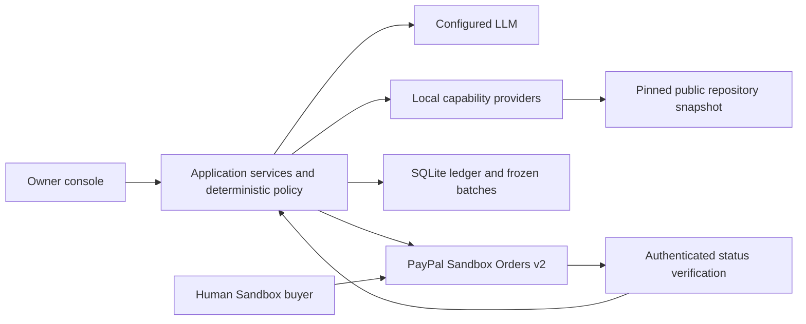

# Credence — Devpost submission draft

Local working draft, 2026-10-25. Not published or submitted. No prize eligibility or general delivery-quality guarantee is claimed.

## Tagline

Let agents trade capabilities, not credentials.

## Inspiration

An agent often needs another capability to finish a task. Giving it payment credentials creates a much broader permission than the task requires. Credence explores a narrower boundary: let agents procure registered services within an owner's internal allowance, verify deliveries, and leave the final external payment to the human.

## What it does

An owner pins a public GitHub repository revision and starts a bounded adoption review. A coordinator selects registered capabilities and authoritative quotes. Local providers perform inventory, architecture analysis and independent risk review. Deterministic code enforces limits, reserves internal Credit, validates delivery evidence and creates one charge per accepted service. The final report cites the accepted deliveries.

The owner can inspect the resulting ledger and combine the three charges into one frozen USD 7.50 bill. A Sandbox Personal buyer approves its PayPal order. The server captures and independently verifies the matching payment before finalizing the settlement and restoring allowance.

## How we built it

Credence uses TypeScript, Node.js, SQLite transactions and an append-only economic ledger. A same-origin vanilla TypeScript console is built with Vite and deployed on one Render Web Service with a persistent disk. DeepSeek supports planning, analysis and synthesis. PayPal OAuth credentials and capture operations stay server-side.

## Challenges and lessons

The difficult boundary is between an uncertain remote payment and final local accounting. Stable business identities, durable attempts, reconciliation and locked uncertain obligations prevent a retry from becoming a second bill. Delivery acceptance is another independent boundary: model text alone cannot authorize a charge. In one live run, an architecture delivery failed evidence validation, then passed a bounded correction without a duplicate service charge.

## What we verified

Five consecutive real browser-only tasks accepted all three services and settled five separate human-approved Sandbox payments. Fresh authenticated PayPal GETs confirmed completed captures, expected amounts, batch identities and the receiver. Each batch retained one create attempt, one capture attempt, one confirmation and three settled charges. Restart/redeploy evidence and 124 automated tests are documented separately.

Evidence: [UI runs](p3-ui-live-evidence.json), [API/redeploy smoke](p3-live-evidence.json), [verification scope](p3-verification.md).

## Boundaries and future work

Credit is a bounded internal accounting allowance, not PayPal credit or lending. All external payments use Sandbox and one Business receiver. Providers run locally; there is no marketplace split, payout or external A2A protocol claim. Evidence checks do not prove every model conclusion is correct. Five-run repeatability used one pinned repository. Physical-device and screen-reader checks are explicitly deferred; Chrome emulation/keyboard checks passed by owner report.

Future work includes broader task-quality evaluation and accessibility testing. Optional sponsor integrations are not represented as implemented.

## Built with

TypeScript, Node.js, SQLite/better-sqlite3, Vite, DeepSeek, PayPal Sandbox OAuth 2.0 and Orders API v2, Render. Render hosting is implemented. Postman remains planned; APIMatic and AG Studio are optional evaluations, not used integrations.

## Links and reviewer access

- Hosted console: https://credence-sandbox.onrender.com/ (owner authentication required).
- Repository: https://github.com/weihong363/credence (public; Apache-2.0).
- Demo video: pending recording and public YouTube upload.
- Open-source license: Apache License 2.0; copyright 2026 Ironion.
- Reviewer access: Render demo plus GitHub local run instructions in [reviewer guide](reviewer-guide.md). The /judge/ entry uses isolated registration-free sessions with a finite 80-call budget; first real three-service execution passed, while guest payment verification still awaits human buyer approval. Local live reproduction uses reviewer-owned Sandbox/LLM credentials. Never publish the deployment OWNER_TOKEN or developer API secrets.
